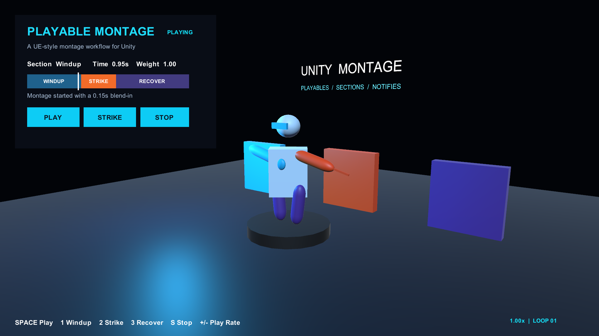

# Unity Montage Demo

Open `Scenes/MontageDemo.unity` and enter Play Mode. The scene demonstrates a
three-section playable montage on a small generic character:

- `Windup` -> `Strike` -> `Recover` section chaining
- full-body slot playback through `MontagePlayer`
- blend-in and blend-out
- an Impact Notify at 1.18 seconds
- runtime play-rate changes and section entry
- automatic replay so the animation remains easy to inspect

## Controls

- `Space`: play the complete montage
- `1`, `2`, `3`: start at Windup, Strike, or Recover
- `S`: stop with blend-out
- `+`, `-`: change play rate between 0.25x and 2x

The same actions are available from the on-screen panel.

## Editor preview

Open **Window > Animation > Unity Montage**, then assign:

- Preview Prefab: `Prefabs/DemoCharacter.prefab`
- Montage: `Montages/DemoAttackMontage.asset`

The montage can then be played, scrubbed, stepped, looped, or constrained to a
single section without entering Play Mode.

The scene and its generated assets can be rebuilt at any time from
**Tools > Unity Montage > Create Demo Scene**.
