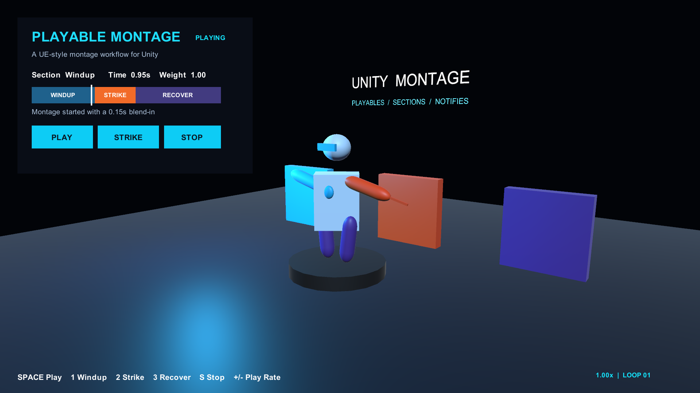

# Unity Montage

基于 Unity Playables 的动画 Montage 插件，围绕 Slot、Section、Notify、混合和打断提供类似 UE Animation Montage 的核心工作流。角色可以继续使用 Animator Controller 驱动基础 Locomotion，再通过 Montage 播放攻击、装填、受击等动作。

仓库包含 UPM 插件、可运行 Demo 和 Unity 开发测试工程。插件包版本为 `0.1.0`，声明最低 Unity 版本为 `2022.3`，当前验证版本为 `2022.3.48f1`。



## 核心功能

| 能力 | 当前实现 |
| --- | --- |
| 动画片段 | AnimationClip 拖放、移动、重排、复制、删除、裁剪，支持源动画范围、片段倒放、循环次数和速率 |
| Section | 分段、边界拖动、连接编辑、自循环、运行时跳段和动态 Next Section |
| Slot 与混合 | AvatarMask、Additive、Slot Group 互斥、跨组并行、优先级打断、淡入淡出曲线 |
| 播放控制 | 起播位置、暂停、继续、定位、速率调整、自动提前淡出、末帧保持和生命周期回调 |
| 事件与曲线 | 多轨道命名 Notify、Notify State、Audio/VFX 事件、精确时间点分支、命名浮点曲线 |
| 编辑器 | 独立角色预览、逐帧采样、帧吸附、时间轴缩放、可调分区、Details 属性编辑和 Undo/Redo |
| 重定向 | Humanoid IK Retargeter、Retarget Pose、双角色预览、手脚 Two-Bone IK 和目标骨架动画烘焙 |

运行时包使用 Unity 内置 API。开发工程另外配置了 UnitySkills 编辑器工具。

## 安装

在 Unity Package Manager 中选择 **Add package from git URL**，输入以下地址。

```text
https://github.com/chnnasn/unity_mongtage.git?path=/Packages/com.chnnasn.montage
```

通过本地仓库安装时，选择 **Add package from disk**，打开 `Packages/com.chnnasn.montage/package.json`。开发插件时，使用 Unity `2022.3.48f1` 打开仓库根目录，插件会作为 Embedded Package 加载。

## 体验 Demo

打开 `Assets/MontageDemo/Scenes/MontageDemo.unity` 并进入 Play Mode。示例角色依次播放 `Windup → Strike → Recover`，展示混合、Impact Notify、跳段和速率控制。

| 按键 | 操作 |
| --- | --- |
| `Space` | 播放完整 Montage |
| `1` / `2` / `3` | 从 Windup / Strike / Recover 开始播放 |
| `S` | 淡出停止 |
| `+` / `-` | 在 0.25x–2x 范围内调整速率 |

打开 **Window > Animation > Unity Montage** 后，可以将以下资源填入窗口进行编辑器预览。

| 字段 | 资源 |
| --- | --- |
| Montage | `Assets/MontageDemo/Montages/DemoAttackMontage.asset` |
| Preview Character | `Assets/MontageDemo/Prefabs/DemoCharacter.prefab` |

## 创建自己的 Montage

1. 在 Project 中选中非 Legacy 的 AnimationClip，执行 **Assets > Create > Montage > From Selected Animation Clip**。也可以先创建 **Montage Asset**，打开后通过 **+ Slot** 添加轨道，再拖入动画。
2. 双击 Montage 资源打开编辑器，设置 Preview Character，选中片段后在 Details 中调整 Clip In/Out、Duration、Play Rate 和 Loop Count。
3. 用 **+ Section** 分段，在 Section Links 中选择下一段。选择自身形成循环，选择 End 结束播放。
4. 用 **+ Notify** 或 **+ State** 添加事件，按需添加 Audio、VFX 和 Curve。
5. 给运行时角色添加 Animator 和 MontagePlayer，并通过代码播放。

```csharp
using ChnnAsn.Montage;
using UnityEngine;

public sealed class CharacterAttack : MonoBehaviour
{
    [SerializeField] private MontagePlayer montagePlayer;
    [SerializeField] private MontageAsset attackMontage;

    public void Attack()
    {
        montagePlayer.Play(attackMontage);
    }
}
```

### 编辑器操作

- 拖动片段主体移动，跨过相邻片段中点后松开可重排，拖动边缘裁剪。
- 选中片段、Section、Notify 或曲线，在右侧 Details 修改参数。
- 拖动预览与 Details 中间的竖条调整宽度，拖动预览下方的横条调整高度。
- **Details** 控制属性面板显示，**Reset Layout** 恢复默认尺寸。布局尺寸和显示状态随窗口序列化保存。
- **Snap** 与 FPS 控制帧吸附，**Zoom** 控制时间轴缩放，底部滚动条用于横向浏览。
- 预览视角使用右键环绕、中键平移、滚轮缩放和 `F` 聚焦。
- **Follow links during entire-montage preview** 用于按 Section 连接顺序预览。

预览采样角色姿态和 Section 连接。Audio/VFX 和游戏 Notify 在运行时执行。完整操作见编辑器文档。[Montage Preview](Packages/com.chnnasn.montage/Documentation~/montage-preview.md)

## 播放与事件约定

- `Play(montage)` 使用资源的 Default Play Rate。通过 MontageHandle 可以暂停、继续、定位、跳段和设置下一段。
- 同名 Slot 或相同非空 Slot Group 的 Montage 相互竞争，优先级决定是否接受播放。不同 Group 且无共享 Slot 的实例可以并行。
- 命名 Notify 的 Asset 可以为空，事件显示名称通过 `context.Notify.Name` 获取。Notify State 提供 Begin、Tick、End 回调。
- Auto Blend Out 默认在最终段结束前启动淡出。将 Blend Out Trigger Time 设为 `0`，淡出会从最终段结束时开始。关闭 Auto Blend Out 会保持末帧，直到停止或被打断。
- Root Motion 可通过 `MontageRootMotionDriver` 应用到角色 Transform，或交给 `IMontageRootMotionReceiver` 接收。

API 示例和事件生命周期见插件说明及运行时文档。[插件 README](Packages/com.chnnasn.montage/README.md) · [Runtime API](Packages/com.chnnasn.montage/Documentation~/runtime-api.md)

## 当前边界

- Montage 时间轴正向推进，单个 Segment 支持负 Play Rate 倒放。
- 沿 Section 连接每帧最多推进 32 次，Slot 的创建顺序决定 Layer Mixer 叠加顺序。
- 浮点曲线通过 API 提供数值，材质、Morph Target 等目标由调用方绑定。
- 重定向以 Humanoid 为主要流程，Generic 动画烘焙要求兼容的 Transform 路径。
- 与 UE 的剩余功能差距包括 Child Montage、Sync Group、Notify 相对/比例时间绑定、任意 Generic 链重采样、网络 Root Motion 同步、Motion Warping 和网络预测。

## 验证与测试

2026-11-12 在 Unity `2022.3.48f1` 的独立验证工程中运行插件与 Demo 脚本测试，共 48 项，46 项通过、0 失败，2 项图形界面测试因无图形模式跳过。测试覆盖播放控制、Section 跳转与循环、Notify 生命周期及回调重入、混合、Slot Group、布局序列化，以及 Demo 的可选 Notify 资源处理。

在 **Window > General > Test Runner** 中选择 EditMode，运行 `ChnnAsn.Montage.Editor.Tests`。命令行运行时，将 `$unityEditor` 设置为本机路径，并在仓库根目录执行以下命令。同一工程应由一个 Unity 实例打开，已有编辑器实例时可以直接使用其 Test Runner。

```powershell
$unityEditor = "D:\UnityEngine\Editors\2022.3.48f1\Editor\Unity.exe"
& $unityEditor `
  -batchmode -nographics -projectPath . `
  -runTests -testPlatform EditMode `
  -assemblyNames ChnnAsn.Montage.Editor.Tests `
  -testResults TestResults\editmode.xml `
  -logFile TestResults\editmode.log
```

窗口绘制和拖拽测试需要图形设备，拖拽测试还需要宿主能够投递鼠标事件。通过 Git URL 单独安装插件时，Demo 集成测试会在缺少开发工程 Demo 脚本的情况下跳过。

## 文档与源码

- 插件源码位于 `Packages/com.chnnasn.montage`，示例工程资源位于 `Assets/MontageDemo`。
- 安装、配置与 API 示例见插件说明。[插件 README](Packages/com.chnnasn.montage/README.md)
- 角色重定向与烘焙步骤见重定向文档。[IK Retargeter](Packages/com.chnnasn.montage/Documentation~/ik-retargeter.md)
- 全部文档入口与版本变更记录如下。[文档索引](Packages/com.chnnasn.montage/Documentation~/index.md) · [Changelog](Packages/com.chnnasn.montage/CHANGELOG.md)
- 项目采用 MIT 许可证。[LICENSE](LICENSE)
